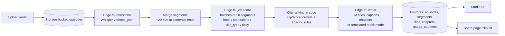

# Podcast Clip Studio

Upload a podcast episode and get a timestamped transcript, AI-picked "clip-worthy" moments, a scrubbable waveform player with clickable chapters, and a shareable page for each clip.

**Jev scores, code cuts, the LLM writes.** Jev (TypeSafe AI's fast decision model) scores every transcript segment for hook strength, standalone-ness, and risk. Plain TypeScript ranks the segments and cuts the clips. The LLM writes only the titles, captions, and chapter names.

## Overview

- **Upload** — drag-and-drop audio (mp3/m4a/wav, max 25 MB) plus an optional show description, or try the bundled **demo episode** (a ~12-minute transcript with precomputed waveform peaks — no audio file needed).
- **Pipeline** — Upload → Transcribe → Jev scoring (with a live counter) → Writing, shown as a progress stepper.
- **Studio** — a waveform player with chapter markers and clip buttons, a synced transcript (current segment highlighted), a "hook heatmap" bar chart coloured by clip type, and clip cards with Jev bars, copyable captions, and raw JSON.
- **Share page** — every clip gets a public page at `/clip/:id` with a mini player that plays just that clip's range.
- **Stats** — Jev call count, total cost, and average latency per episode.

## Architecture



## Why a fast scorer + code beats one big LLM call

Asking a single LLM to "pick the best clips" from a full transcript is slow, expensive, and un-auditable: you get one opaque blob of prose, no per-segment confidence, and no way to tune the ranking without re-prompting. Splitting the work fixes each problem:

- **Jev is a fast decision model.** It answers many small, atomic questions in one request (batched 10 segments per call), so scoring an entire episode costs cents and a few seconds — and every segment gets explicit hook/standalone/risk numbers with confidence.
- **Ranking in code is auditable and testable.** The `clipScore` formula, the 60-second spacing rule, the risky-content gate, and the filler penalty are pure TypeScript — unit-testable, tweakable, and deterministic. Change a weight and re-cut instantly without re-scoring.
- **The LLM only writes.** Titles, captions, and chapter names are exactly what language models are good at. Everything numeric or structural is done by Jev or code. If the writer key is missing (or mock mode is on), templated titles and 5-minute chapters keep the app fully functional — Jev still runs live.

## Setup

```bash
# Set secrets (server-side only, never in the browser)
supabase secrets set TYPESAFE_API_KEY=... OPENAI_API_KEY=...

# Deploy the 3 edge functions
# (transcribe, jev-score, writer)

npm install
npm run dev
```

If `TYPESAFE_API_KEY` or `OPENAI_API_KEY` are absent, the demo episode still works end-to-end in mock mode with templated copy.

### Environment variables

| Variable | Where | Default | Purpose |
| --- | --- | --- | --- |
| `TYPESAFE_API_KEY` | Edge function secret | — | Jev scoring API |
| `OPENAI_API_KEY` | Edge function secret | — | Whisper transcription + writer LLM |
| `OPENAI_BASE_URL` | Edge function secret | `https://api.openai.com/v1` | OpenAI-compatible endpoint override |
| `OPENAI_TRANSCRIBE_MODEL` | Edge function secret | `whisper-1` | Transcription model |
| `OPENAI_MODEL` | Edge function secret | `gpt-6-luna` | Writer model (no `temperature` param) |
| `VITE_SUPABASE_URL` | Frontend env | pre-configured | Supabase project URL |
| `VITE_SUPABASE_ANON_KEY` | Frontend env | pre-configured | Supabase anon key |

## Screenshots

| Upload | Studio |
| --- | --- |
| _screenshot: upload page_ | _screenshot: studio with waveform + clips_ |

| Clip card | Share page |
| --- | --- |
| _screenshot: clip card with Jev bars_ | _screenshot: public clip share page_ |

## Design decisions

1. **Batched Jev calls (10 segments/request).** Jev answers many questions in one request, so one HTTP call scores 10 segments × 4 questions = 40 answers. On validation failure or question-limit errors the batch is split in half and retried; 429/529 responses retry with exponential backoff (3 tries). Cost is computed as `input_tokens × $0.042 / 1M` (output tokens are free).
2. **Ranking in code.** `clipScore = (hook/4) × (0.6 + 0.4·standalone) × (risky ≥ 0.5 ? 0 : 1) × (filler ? 0.2 : 1)`. Top 5 non-overlapping clips with ≥ 60 s spacing, 15–75 s duration, one-segment backward extension when `standalone < 0.5`, and a "low confidence" flag when hook confidence < 0.4.
3. **The risky-content gate.** Any segment Jev flags as risky (probability ≥ 0.5) is hard-gated to score 0. A clip that could be defamatory or embarrassing out of context never makes the top 5, no matter how strong the hook.
4. **Daily cap.** Every function counts calls per UTC day in `usage_counters` (atomic increment via a SQL function). Above 200 calls/day per function, functions return `429 {error:"daily_cap"}` and the UI switches to the bundled demo episode with a "Daily demo limit reached" banner.
5. **Exactly 3 edge functions.** `transcribe`, `jev-score`, `writer` — all external API calls stay server-side; keys never reach the browser. The frontend talks to Supabase directly for data and Storage.
